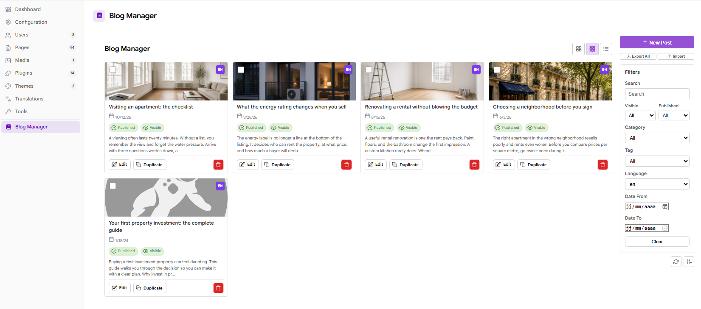
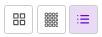
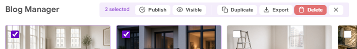

# Blog Manager Plugin for Grav CMS 2.x


A modern **Admin2 (Grav 2.x) plugin** that provides a dashboard for managing blog posts directly in the Admin Next SPA. Browse posts in grid or list view, filter by date, category, tag, or language, create and duplicate posts, export or import ZIP archives, and toggle publish/visible status inline — all without leaving the admin interface.



## Features

- 📋 **Three View Modes** — Big cards (2-col), small cards (4-col), and list view with column headers
- ✏️ **Native Editor Integration** — Edit posts using Grav's built-in page editor
- ➕ **Create New Posts** — Auto-generates folder and frontmatter, redirects to native editor
- 📑 **Duplicate Posts** — Copies the folder to `slug-copy` (then `slug-copy-2`). Each language title gains `(Copy)`, and every language is unpublished
- 🗑️ **Delete with Modal** — Styled confirmation modal instead of browser alert
- 🔄 **Inline Status Toggle** — Click Published/Visible badges to toggle without page reload
- 🔍 **Filter Panel** — Search by text, filter by Published, Visible, Category, Tag, Language, and Date Range
- 📅 **Date Range Filter** — Begin date / End date inputs (native HTML5 date pickers)
- 🖼️ **Thumbnail Images** — Card images use the post's own page file. A post with no raster image uses the Grav logo.
- 💾 **Persistent View** — Remembers selected view mode across sessions
- ✅ **Multi-Select** — Click to toggle, Shift+click for range selection
- ✅ **Bulk Actions** — Bulk Publish, Visible, Duplicate, Delete, Export, and Clear, with confirmation modals for delete and duplicate
- 📦 **Export & Import** — Export selected posts or every post as a ZIP. Import a ZIP of post folders from the sidebar.
- 🔄 **Scan and Parameters** — Two square icon buttons sit on the right, under the filters. Scan looks for articles. Parameters opens the plugin settings. The same scan is also beside Blog Path on the settings page.
- 🔁 **Any Grav blog page** — Blog Path accepts the route Grav gives that page, including a numbered folder such as `03.blog` and a nested route such as `/news/blog`
- 📂 **Language-Specific Items** — Supports blog's `item.md` and `item.{lang}.md` files
- 🌍 **Locale-Aware Dates** — Uses `Intl.DateTimeFormat` for localized date display
- 🌐 **English, French, Spanish, Italian, and German** — Interface strings live in the web component and the blog-path field. Blueprint and permission labels live in `languages/`. Short codes (`en`, `fr`, `es`, `it`, `de`) and Admin2 regional codes (`en-US`, `fr-FR`, `es-ES`, `it-IT`, `de-DE`, and the other aliases in `languages.yaml`) all resolve.
- 🎨 **External CSS** — Styles in a separate `blog-manager.css` for browser caching
- 🌙 **Dark mode** — Light theme until Admin2 is switched to dark.

## Installation

### Manual Installation

1. Download the latest release
2. Extract the archive to `user/plugins/`
3. Rename the folder to `blog-manager`
4. Clear the Grav cache (`bin/grav clear-cache`)

### Via GPM

```bash
bin/gpm install blog-manager
```

## Requirements

- Grav CMS 2.0.0+
- PHP 8.3+
- API plugin 1.0.0+
- Admin2 plugin 2.0.0+

## Configuration

After installation, go to **Plugins → Blog Manager** to configure:

| Option | Description | Default |
|--------|-------------|---------|
| Plugin Enabled | Enable or disable the plugin | Yes |
| Blog Path | Route path to the blog page | `/blog` |

The post list resolves **Blog Path** on each request. A top-level page such as `03.blog` and a nested page such as `01.news/02.blog` both match.

### Permissions

| Permission | Allows |
|------------|--------|
| `blog-manager.posts.read` | List posts and scan the blog folder |
| `blog-manager.posts.write` | Create, duplicate, toggle status, and import |
| `blog-manager.posts.delete` | Delete posts |
| `blog-manager.posts.export` | Download ZIP exports |

## Usage

### Blog Detection

**Blog Path** is the route of the blog page, not a folder on disk. `/blog` and a nested route such as `/news/blog` are both accepted. Leading and trailing slashes are ignored.

Grav's own page is used when that route is already declared. Otherwise each segment is matched to a folder under `user/pages`, then to a folder inside the previous match. A leading number and dot are removed first, so `blog` and `03.blog` both match `/blog`, and `01.news/02.blog` matches `/news/blog`. If two folders reduce to the same slug, the first one found is used.

A post is a folder directly inside that blog folder which contains `item.md` or `item.{lang}.md`. The post folder itself may be numbered (`01.my-post`) or plain (`my-post`). Folders without an article file are skipped. The dashboard lists every language file in that folder, so `item.md` and `item.en.md` each appear with their own title. Edit opens that language.

**Scan for articles** on the settings page checks the path typed in the field, even before it is saved. The dashboard button uses the saved Blog Path, reports how many article folders it found, and reloads the list. A missing folder is reported as not found.

If the list stays empty, confirm Blog Path, run Scan, then reload Blog Manager.

### Blog Manager Interface

Navigate to **Blog Manager** in the Admin Next sidebar (book icon). Posts are loaded from your blog folder and displayed in the selected view mode.

#### View Modes



- **Big Cards** (2 columns) — Full post cards with thumbnail, excerpt, and metadata
- **Small Cards** (4 columns) — Compact cards for quick scanning
- **List** — Table-style view with columns for Title, Lang, Excerpt, Date, Category, Published, Visible, Tags, Actions

#### Post Actions


- Click a **post title** or the **Edit** button to open it in Grav's native page editor
- Click **Published** or **Visible** badges to toggle status inline
- Use **Duplicate** to copy a post. The new folder is `slug-copy`, or `slug-copy-2` when that name is taken. The copy is unpublished. A new post uses the slug itself, then `slug-2`.
- Use **Delete** to remove it permanently (with confirmation modal)

#### Bulk Actions



Use the checkbox on each post, or the header **Select all** checkbox in list view, to select posts. **Shift+click** selects the range between the last clicked post and the current one. The bulk bar then offers Publish, Visible, Duplicate, Export, Delete, and Clear.

#### Sidebar

- **New Post** — Creates an unpublished post folder from the slug, then opens it in Grav's page editor
- **Export All** — Downloads every loaded post as a ZIP file. Selected export remains on the bulk bar.
- **Import** — Uploads a ZIP of post folders. Entries that leave the archive, or that are not post folders, are rejected. A slug that is already a page is saved as `slug-2`.
- **Filter Panel** — Search, filter by status, date range, category, tag, language
- **Scan for articles** — Square refresh button on the right, under the filters. Counts every child folder that contains an article, including folders without a numeric prefix, then reloads the list.
- **Parameters** — Square sliders button beside Scan. Opens **Plugins → Blog Manager**.

> **Usage hint:** When creating or editing a blog post, after saving, hit the browser back button to return to the Blog Manager.

### Post Structure

Posts live in child folders of the blog page. A numeric prefix is optional. Each post has `item.md`, `item.{language}.md`, or both:

```
user/pages/
  {03.}blog/
    {01.}post-one/
      item.md
      item.fr.md
      pic01.jpg
    {02.}post-two/
      item.md
      item.en.md
```

The blog folder is resolved from **Blog Path** as described in [Blog Detection](#blog-detection). Language-specific item files such as `item.fr.md` and `item.en.md` are supported.

## File Structure

```
blog-manager/
├── blog-manager.php              # Main plugin class (Admin2 events, API routes)
├── blog-manager.yaml             # Default configuration (required for the Plugins page)
├── blueprints.yaml               # Plugin configuration form
├── permissions.yaml              # Read, write, delete, and export permissions
├── languages/
│   ├── en.yaml                   # English blueprint and permission strings
│   ├── fr.yaml                   # French blueprint and permission strings
│   ├── es.yaml                   # Spanish blueprint and permission strings
│   ├── it.yaml                   # Italian blueprint and permission strings
│   ├── de.yaml                   # German blueprint and permission strings
│   └── languages.yaml            # Same labels for short and regional language codes
├── classes/
│   └── BlogManagerApiController.php  # API endpoint handlers
├── admin-next/
│   ├── pages/
│   │   └── blog-manager.js       # Web component for Admin2 SPA
│   └── fields/
│       └── blog-path.js          # Blog Path field with scan button
├── assets/
│   ├── blog-manager.css          # All plugin styles
│   └── images/
│       ├── grav-cms-logo.svg     # Logo used when a post has no raster image
│       └── readme/               # README screenshots
├── README.md
├── CHANGELOG.md
└── LICENSE
```

## Support

- **Issues:** [https://github.com/DrDroid-FR/grav-plugin-blog-manager-2/issues](https://github.com/DrDroid-FR/grav-plugin-blog-manager-2/issues)
- **Author:** Dr Droid <gravdev@drdroid.fr>
- **GitHub:** https://github.com/DrDroid-FR

## License

MIT License - see [LICENSE](LICENSE) file for details.

---

Made with ❤️ by [Dr Droid](https://github.com/DrDroid-FR)

